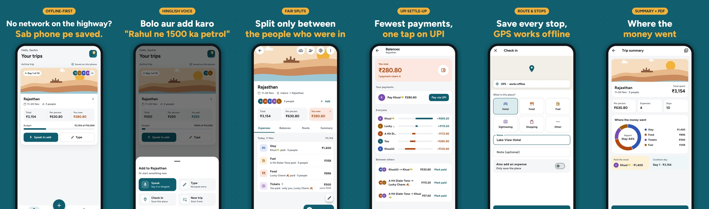
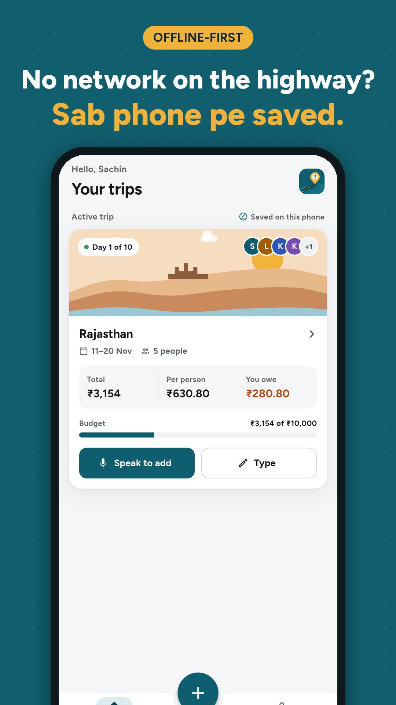
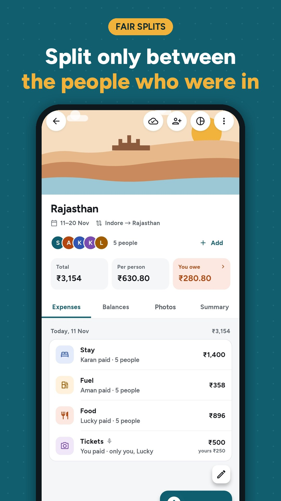
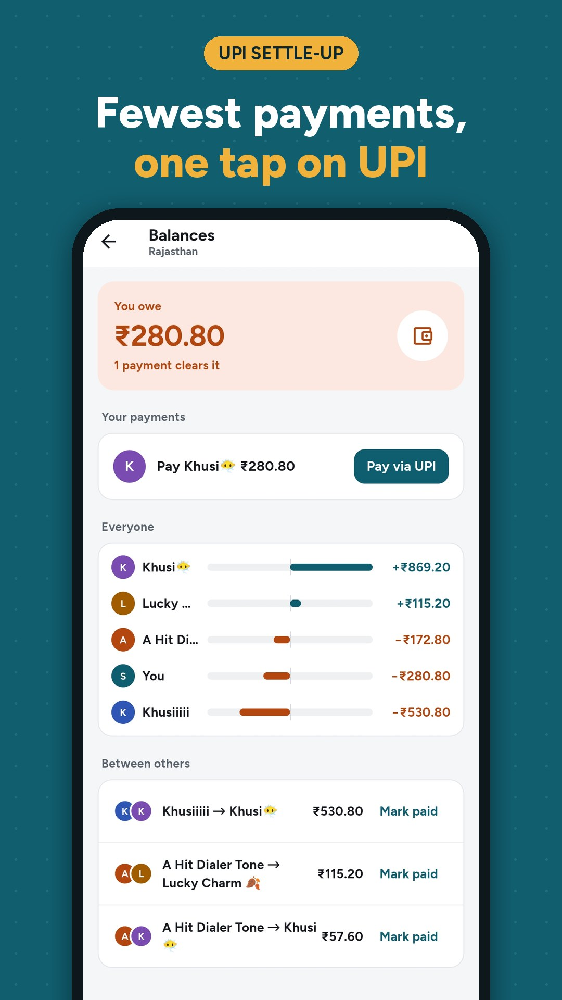
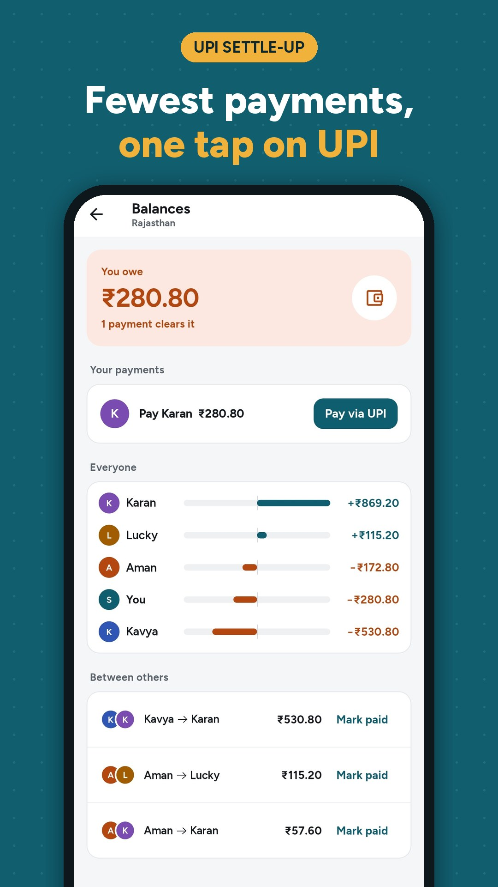
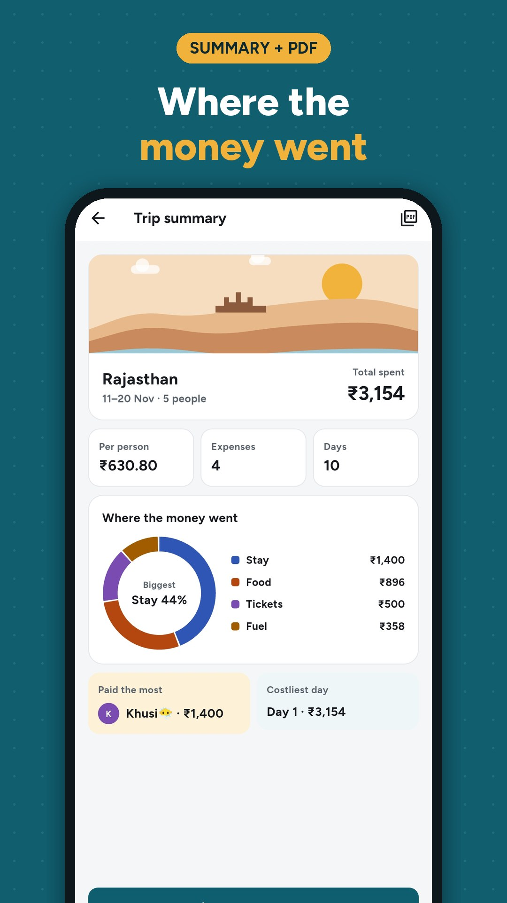
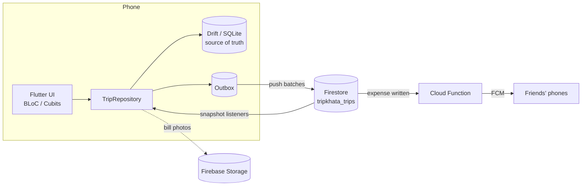

<div align="center">


# TripKhata

**Split group trip expenses: offline, by voice, settled over UPI.**

Say *"Rahul ne 1500 ka petrol bharwaya"* and it's saved, split and added to everyone's balance.
No signal on the highway? It still works.

[](https://github.com/SachinChoudhary07/Trip-Khata/actions/workflows/build.yml)
[](https://github.com/SachinChoudhary07/Trip-Khata/releases/latest)


[**Download the APK**](https://github.com/SachinChoudhary07/Trip-Khata/releases/latest) ·
[Privacy policy](https://sachinchoudhary07.github.io/Trip-Khata/privacy/) ·
[Firebase setup](docs/CLOUD_SETUP.md)

<br />



</div>

---

## Why

On a group trip, one person pays for petrol, another for the dhaba, someone else for the hotel. The WhatsApp group fills up with "1500 – petrol", "who paid the toll?", and at the end someone totals it all by hand.

TripKhata is built for Indian road trips:

- **Highways have no network**, so everything is saved on the phone first.
- **People talk in Hinglish**, so you can add an expense by just saying it.
- **Not everyone buys everything.** Two friends buy keychains, the third doesn't pay for them.
- **Everyone has UPI**, so settling up is one tap to GPay or PhonePe.

## Screenshots

| | | |
| :---: | :---: | :---: |
|  |  |  |
| **Offline-first.** Everything is saved on the phone. | **Hinglish voice.** Say it, it's saved and split. | **Fair splits.** Only the people who were in pay. |
|  |  | |
| **UPI settle-up.** Fewest payments, one tap to pay. | **Summary + PDF.** See where the money went. | |

## Features

### Add expenses fast
- **Speak to add**: on-device speech recognition plus a Hinglish parser. *"pandrah sau"*, *"dedh hazaar"*, *"2k"*, *"sab mein baant do"* all work. Anything it isn't sure about is highlighted for a one-tap fix.
- **Numpad entry** with categories, who paid, and a date.
- **Home screen widget** with a mic button. Tap it, speak, save, and you're back on your home screen.
- **One active trip at a time**, so quick add, voice and the widget always know where the expense goes.

### Split it fairly
- Split **equally**, **by amount** or **by shares** (2 rooms : 1 room), down to the paisa. All money is stored in paise.
- Split **only between the people who were part of it**. Others still see the entry, marked *Not in your share*, so nothing is hidden.
- Add people **from contacts**, or mid-trip when someone joins on day 2.

### Settle up
- Balances and the **fewest payments** to clear the trip (at most *n − 1* for *n* people).
- **Pay by UPI** with the amount pre-filled (`upi://pay`), then mark it paid.

### Remember the trip
- **Trip summary** with where the money went, who paid the most and the costliest day. Share it, or export a **PDF** or **CSV**.
- **Bill photos** on any expense.

### Together, in sync
- **Invite links per person**. Each friend gets their own link: one tap opens the app and joins them as themselves (Android App Links, no paid service). A 6-letter code works too.
- **Offline-first sync**: edits queue up on the phone and sync when there's signal.
- **Push notifications** when a friend adds an expense (*"Rahul added ₹1,500 · your share ₹375"*), even when the app is closed.
- **Budget alerts** at 80% and 100%, and a daily 9 PM reminder to log the day's spends.

### Respectful of your data
- Trips stay on your phone unless you share them.
- Shared trips can only be read by the people in them.
- **Delete account** from inside the app.
- No ads, no tracking.

## How it works



- **The phone is the boss.** Every write goes to SQLite first. If the trip is shared, the change is also added to an outbox.
- The **sync service** pushes the outbox to Firestore in batches. When offline, Firestore holds the batch and sends it later.
- Friends' changes come back through **snapshot listeners** and are written locally without being queued again, so nothing echoes back and forth.
- **The latest edit wins** (`updatedAt`). A deleted expense leaves a tombstone so every phone removes it.
- A **Cloud Function** on each expense write sends a personalised push to the rest of the group via FCM.

## Tech stack (₹0 to build and run)

| Layer | Choice |
| --- | --- |
| App | Flutter, Dart 3, `flutter_bloc` (Cubits), `go_router` |
| Local data | Drift (SQLite), amounts in paise |
| Voice | `speech_to_text` (on-device), custom Hinglish parser in Dart, no paid AI API |
| Payments | UPI deep links via `url_launcher`, no payment gateway |
| Cloud | Firebase Auth (Google sign-in), Firestore, Storage, Cloud Functions, FCM, Crashlytics |
| Notifications | `flutter_local_notifications` + `firebase_messaging` |
| Widget | `home_widget` + a native `RemoteViews` layout |
| Export | `pdf` + `printing`, CSV, `share_plus` |
| CI | GitHub Actions: tests, signed APK, GitHub Release |

Firebase runs on the Blaze plan, but normal use stays inside the free monthly quota.

## Project structure

```
lib/
  core/            theme, router, money (paise), notifications, shared widgets
  db/              Drift tables and migrations
  features/
    trips/         repository, home, trip page, active trip, budget alerts
    expenses/      add/edit expense, split calculator, expense detail, bill photo
    voice/         speak-to-add screen, Hinglish parser
    settle/        balances, settlement calculator, UPI
    summary/       trip summary, PDF
    cloud/         sync service, share/join, push tokens, account
    widget/        home screen widget bridge
    profile/ onboarding/ splash/ shell/
functions/         Cloud Functions (push, cleanup) + unit tests
tool/              patch_android.dart and the native widget files it installs
docs/              Firebase setup guide, privacy policy (GitHub Pages)
test/              domain, repository, sync and widget tests
```

## Run it locally

You need the Flutter SDK (stable) and Android Studio or an Android device.

```bash
git clone https://github.com/SachinChoudhary07/Trip-Khata.git
cd Trip-Khata

# The android/ folder is generated, not committed.
flutter create --org com.tripkhata --project-name tripkhata --platforms=android .
flutter pub get
dart run tool/patch_android.dart        # permissions, UPI queries, widget, Firebase Gradle plugins, signing
dart run flutter_launcher_icons
dart run build_runner build --delete-conflicting-outputs   # Drift code

flutter test
flutter run
```

Cloud features (sign-in, sharing, push, bill sync) need the Firebase steps in [docs/CLOUD_SETUP.md](docs/CLOUD_SETUP.md). Without them, the app works fully offline on one phone.

### Cloud Functions

```bash
cd functions && npm ci && npm test && cd ..
firebase deploy --only functions:tripkhata --project <your-project-id>
```

The functions use their own codebase (`tripkhata`), so deploying them never touches other apps' functions in a shared Firebase project.

## CI and releases

Every push to `main` runs [`build.yml`](.github/workflows/build.yml):

1. Generates `android/` and runs `tool/patch_android.dart`
2. Runs `flutter test` and the Cloud Functions tests
3. Builds a signed release APK and uploads it as an artifact
4. Publishes a **GitHub Release** with the APK when the commit message contains `[release]`. The version comes from `pubspec.yaml`.

## Roadmap

- [ ] Battery-optimisation helper for Xiaomi, Oppo, Vivo and similar phones
- [ ] Play Store release with a private signing key
- [ ] iOS

## Privacy

Read the [privacy policy](https://sachinchoudhary07.github.io/Trip-Khata/privacy/) to see what is stored and where. You can [delete your account and data](https://sachinchoudhary07.github.io/Trip-Khata/privacy/#delete) from inside the app.

## Author

Built in public by **Sachin Choudhary**, a Flutter developer from Indore.
Issues and ideas are welcome: [open an issue](https://github.com/SachinChoudhary07/Trip-Khata/issues).
